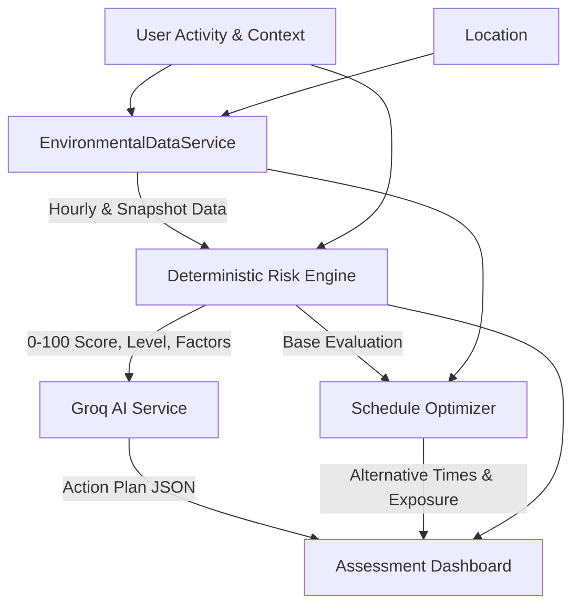

# HeatShield AI

**An AI-powered climate safety platform that assesses heat and air-quality risks, delivers personalized safety guidance, and finds safer times for outdoor activities.**

Built for **ForgeHacks Online 2026 — AI + Climate**.

## Problem Statement

Outdoor workers (such as street vendors, delivery workers, and construction crews) and vulnerable residents face dangerous environmental exposure, particularly during periods of high heat and poor air quality. General weather forecasts provide raw temperatures but fail to translate into practical, personalized decisions about when to work, when to rest, and how to reduce exposure. There is a critical need for understandable, localized, multilingual safety recommendations tailored to individual activity constraints.

## Solution Overview

HeatShield AI tackles this by providing an integrated environmental safety workflow:

1. **Context Gathering:** Collects destination, activity type, intensity, and schedule.
2. **Environmental Data:** Fetches location-specific snapshots and hourly conditions (currently running in a deterministic fallback mode for demonstration).
3. **Risk Assessment:** A deterministic engine calculates a risk score (0–100) and identifies contributing factors.
4. **AI-Generated Action Plans:** Groq AI translates the risk profile into a structured, personalized safety plan in English or Tamil.
5. **Schedule Optimization:** Automatically evaluates alternative start times across the day to find options with reduced heat and exposure.
6. **Unified UI:** Presents the findings in a clean, accessible Next.js dashboard.

## Key Features

* **Deterministic Risk Engine:** Calculates risk score and assigns a category (`LOW`, `MODERATE`, `HIGH`, `VERY_HIGH`) based on heat, air quality, duration, and activity intensity.
* **Schedule Optimizer:** Generates candidate times (in 30-minute intervals between 06:00 and 20:00) to find the safest schedule while preserving activity duration.
* **AI Action Plans:** Uses Groq (`llama3-8b-8192`) to generate actionable safety steps. Includes a gracefully degrading fallback when credentials are not present.
* **Multilingual Support:** Action plans are natively generated in English or Tamil.
* **Environmental Fallback Data:** Fully testable without external weather APIs via a deterministic data generator.
* **User Dashboard:** Full authentication flow (mocked), user profiles, settings, and assessment history persistence.

*(Note: Live weather APIs and actual production database integrations are planned future enhancements. The current repository focuses on the core risk evaluation and AI generation logic).*

## How It Works



## Risk Assessment Methodology

The application calculates risk deterministically to ensure consistent, explainable results before invoking AI. The engine evaluates:

* **Heat (40%):** Based on temperature and humidity thresholds.
* **Air Quality (25%):** Based on AQI levels (weights adjust if missing).
* **Activity Intensity (15%):** Scales by metabolic heat (Light, Moderate, Heavy).
* **Duration (10%):** Exponential risk increase for prolonged exposure.
* **Time of Day (10%):** Penalizes peak solar radiation hours (11:00 - 15:00).

**Risk Categories:**
* 0-24: LOW
* 25-49: MODERATE
* 50-74: HIGH
* 75-100: VERY HIGH

## Schedule Optimization

The schedule optimizer identifies safer activity windows by evaluating candidate start times every 30 minutes from `06:00` to `20:00`. It ensures the user's required activity duration remains unchanged while minimizing the integrated risk score across the timeline. The UI presents the estimated exposure reduction (as a percentage) to help users make informed scheduling trade-offs.

## AI Integration

HeatShield AI utilizes **Groq** to generate highly contextual safety plans.
* **Model:** `llama3-8b-8192`
* **Role:** Translates the deterministic risk score into structured JSON containing summaries, key factor explanations, prioritized actions, and scheduling guidance.
* **Resilience:** The application filters out hallucinations (e.g., medical diagnoses) and falls back to a built-in static guide in the requested language if the API is unreachable.

## Technology Stack

| Role | Technology | Notes |
| :--- | :--- | :--- |
| **Framework** | Next.js 16 (App Router) | React 19, TypeScript |
| **Styling** | Tailwind CSS v4 | Uses Google Material Icons |
| **AI Provider** | Groq API | Utilizes `llama3-8b-8192` for fast JSON inference |
| **Testing** | Playwright | Full E2E coverage of risk engine & UI flows |

## Installation and Local Setup

1. **Clone the repository:**
   ```bash
   git clone https://github.com/Sanjaycs096/HEATSHIELD-AI.git
   cd heatshield-app
   ```

2. **Install dependencies:**
   ```bash
   npm install
   ```

3. **Configure Environment Variables:**
   Copy the example environment file:
   ```bash
   cp .env.example .env
   ```
   Add your API keys to `.env`:
   ```env
   GROQ_API_KEY=your_groq_api_key_here
   GROQ_MODEL=llama3-8b-8192
   ```

4. **Start the development server:**
   ```bash
   npm run dev
   ```
   *(Windows users can double-click `start_project.bat` to automatically apply DNS workarounds and start the server).*

5. Open [http://localhost:3000](http://localhost:3000) in your browser.

## Environment Variables

| Variable | Purpose | Required | Example |
| :--- | :--- | :--- | :--- |
| `GROQ_API_KEY` | Authenticates with Groq for AI Action Plans | No (has fallback) | `gsk_...` |
| `GROQ_MODEL` | Specifies the LLM to use | No | `llama3-8b-8192` |

## Usage Guide

1. **Launch the App:** Open the landing page and click "Get Started" to reach the Sign In page. (You can register a test account or use demo credentials).
2. **Create an Assessment:** From the dashboard, select "New Assessment". Enter a location (e.g., "Madurai"), an activity (e.g., "Street Vending"), a schedule (e.g., 10:00 to 14:00), and a duration.
3. **Review Results:** The preview page displays your 0-100 Risk Score, Environmental Snapshot, and Schedule Optimization alternatives.
4. **Read AI Action Plan:** Review the personalized, language-specific safety plan generated by Groq.
5. **View History:** Navigate to the History tab to review previous assessments.

## Testing

The project includes extensive E2E and unit testing via Playwright, validating the risk algorithms, schedule optimizer, fallback generators, and UI flows.

```bash
# Run the linter
npm run lint

# Run all Playwright tests
npx playwright test
```

## Project Structure

```
heatshield-app/
├── src/
│   ├── app/                 # Next.js App Router
│   │   ├── (authenticated)/ # Protected dashboard and assessment routes
│   │   └── (public)/        # Landing page, login, and registration
│   ├── components/          # Reusable UI (AppShell, Sidebar, Header)
│   └── lib/                 # Core logic
│       ├── riskEngine.ts    # Deterministic risk algorithm
│       ├── scheduleOptimizer.ts # Exposure reduction logic
│       ├── groqService.ts   # AI Action Plan generation
│       └── envService.ts    # Environmental data fallback provider
├── tests/                   # Playwright E2E and unit tests
├── public/                  # Static assets
└── package.json             # Dependencies and scripts
```

## Limitations & Safety Disclaimer

**HeatShield AI is an informational decision-support tool. Its estimates and recommendations are not medical advice or a diagnosis.**
It does not replace official weather warnings, local public-health guidance, emergency services, or advice from qualified professionals. Users should always follow official alerts and seek a cooler environment when conditions warrant. A lower estimated risk score or a recommended alternative time does not guarantee safe conditions. The current version utilizes deterministic fallback environmental data for demonstration purposes; live metrics depend entirely on the accuracy of third-party weather integrations.

## Future Improvements

* **Live Environmental API:** Connect to Open-Meteo or similar for real-time weather and AQI data.
* **Expanded Languages:** Add Hindi, Bengali, and other regional dialects.
* **SMS Notifications:** Push schedule alerts to workers without smartphone access.
* **Team Dashboard:** Allow construction supervisors to assess risk for entire crews.
